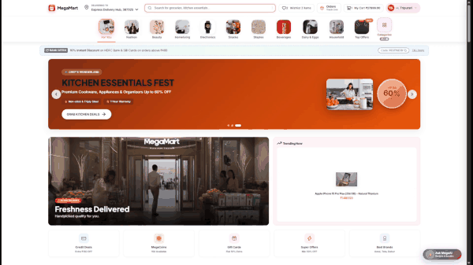

<div align="center">

# MegaMart

**High-Performance Quick-Commerce Web Architecture with Immutable State & Real-Time Logistics**

[](https://mega-mart-web.vercel.app/)
[](docs/assets/walkthrough.mp4)
[](https://developer.mozilla.org/en-US/docs/Web/JavaScript)
[](https://vitejs.dev/)
[](https://supabase.com/)
[](LICENSE)

<br />

<!-- Responsive Media Showcase -->
<a href="docs/assets/walkthrough.mp4" target="_blank" rel="noopener noreferrer">
  
</a>

<p align="center">
  <sub>Live preview • <a href="docs/assets/walkthrough.mp4"><b>Watch Full 1080p Video Walkthrough (3:00)</b></a> • <a href="https://mega-mart-web.vercel.app/"><b>Open Production Deployment</b></a></sub>
</p>

</div>

---

## Overview

MegaMart is an engineering-first quick-commerce web application engineered for low-latency product discovery, instant basket manipulation, and simulated hyper-local order fulfillment.

Built using an unopinionated, zero-dependency **Model-View-Controller (MVC)** design pattern, the system prioritizes client-side performance, immutable data protection against DOM-based price tampering, sub-millisecond catalog filtering, and resilient state synchronization.

---

## System Architecture

The application enforces a unidirectional data flow and strict separation of concerns across Model, View, and Controller layers:

```
[ User Interaction ]
         │
         ▼
 ┌──────────────┐          Dispatches Events
 │  View Layer  │ ─────────────────────────────────┐
 └──────────────┘                                  │
         ▲                                         ▼
         │ Re-renders with Fresh State    ┌──────────────────┐
         └─────────────────────────────── │ Controller Layer │
                                          └──────────────────┘
                                                   │
                                                   ▼ Updates & Validates
                                          ┌──────────────────┐
                                          │   Model Layer    │
                                          │ (Frozen State &  │
                                          │  LocalStorage)   │
                                          └──────────────────┘
```

### Layer Responsibilities

- **Model Layer (`model/model.js`)**: Serves as the single source of truth (SSOT). Maintains catalog data, variant pricing matrices, inventory states, and shopping cart persistence. Employs `Object.freeze` defensively on price-critical objects to protect against client-side manipulation.
- **View Layer (`view/containerView.js`, `view/headerView.js`, `view/cartView/`)**: Pure presentation layer utilizing native event delegation. Responsible for DOM updates, micro-animations, skeleton loader transitions, and modal overlays. Contains zero business or pricing logic.
- **Controller Layer (`controller/controller.js`)**: Mediates communication between Model and View. Intercepts user inputs (search queries, filter changes, cart modifications), invokes corresponding model mutators, and requests targeted view re-renders.

---

## Engineering Highlights

### 1. Defensive State & Immutable Pricing Engine
- Cart operations execute through authoritative calculation functions rather than relying on DOM-bound data attributes.
- Cumulative savings calculations dynamically compute Manufacturer Suggested Retail Price (MSRP) deltas, coupon promotions, and loyalty credit deductions with strict decimal rounding.
- Defensive schema validators intercept corrupted or out-of-date records in `localStorage` upon initialization, seamlessly migrating or resetting to a stable state.

### 2. Multi-Variant Pack Matrix & Dynamic Bundling
- Supports multi-weight SKUs (e.g., 500g, 1kg, 2kg) with non-linear discount curves that automatically update unit economics across all visible UI components simultaneously.
- Rule-based bundling engine dynamically computes Frequently Bought Together (FBT) package discounts and provides single-action multi-item dispatch to the cart state.

### 3. Hyper-Local Logistics State Machine
Simulates an automated 5-stage dark store fulfillment pipeline:
1. `ORDER_CONFIRMED`: Verifies order payload and generates cryptographically secure simulated tracking tokens.
2. `INVENTORY_PACKED`: Allocates items at the nearest fulfillment micro-hub.
3. `COURIER_ASSIGNED`: Binds driver metadata (name, rating, vehicle identifier).
4. `OUT_FOR_DELIVERY`: Initiates live sonar telemetry simulation.
5. `FULFILLED`: Terminal delivery verification requiring one-time passcodes (OTP).

### 4. Client-Side Performance & Accessibility
- **Targeted Event Delegation**: Global click, change, and submit events are bound at root container boundaries, minimizing listener overhead across thousands of dynamic nodes.
- **Progressive Image Loading**: Responsive lazy loading with intrinsic placeholder dimensions to eliminate Cumulative Layout Shift (CLS).
- **Cursor Magnification**: Mathematical bounding-box calculation for 1.45x magnification lenses without heavy external canvas libraries.

---

## Technology Stack

| Domain | Technology | Specification / Purpose |
| :--- | :--- | :--- |
| **Language** | JavaScript (ES6+) | Modern standard without heavy runtime abstraction |
| **Markup & Styles** | HTML5, CSS3 Tokens | Modular custom properties, 8pt grid system, fluid typography |
| **Tooling** | Vite 4.4 | Fast HMR development server and optimized Rollup bundling |
| **Icons & Motion** | Lucide Icons, GSAP | Lightweight iconography and hardware-accelerated animations |
| **Storage & Database**| Supabase / LocalStorage | PostgreSQL cloud integration with robust local fallback |
| **Hosting** | Vercel | Global edge CDN deployment |

---

## Directory Structure

```
MegaMart/
├── docs/
│   └── assets/               # Technical walkthroughs and media artifacts
├── controller/
│   └── controller.js         # Event orchestration, search, filter, and routing logic
├── model/
│   └── model.js              # Catalog schema, stock records, and immutable cart engine
├── view/
│   ├── containerView.js      # Core UI rendering, event delegation, and modal manager
│   ├── headerView.js         # Navigation bar, search input, and location badge
│   ├── addandSubButton.js    # Quantity step controls with debounced handlers
│   └── cartView/             # Cart drawer, checkout stepper, and savings calculator
├── public/                   # Static assets, manifests, and favicon packages
├── index.html                # Semantic root template and skeleton overlays
├── style.css                 # Design tokens, utility classes, and layout rules
└── package.json              # Project scripts and dependencies
```

---

## Installation & Setup

### Prerequisites
- Node.js (v18.0.0 or higher recommended)
- npm or pnpm

### 1. Clone the Repository
```bash
git clone https://github.com/sahaniTripurari/MegaMartWeb.git
cd MegaMartWeb
```

### 2. Install Dependencies
```bash
npm install
```

### 3. Configure Environment Variables
Copy the template configuration file:
```bash
cp .env.example .env
```
Populate optional configuration keys if integrating external services:
```env
# Optional Gemini AI Assistant Configuration
VITE_GEMINI_API_KEY=your_gemini_api_key_here

# Optional Supabase Database Connection
VITE_SUPABASE_URL=https://your-project-id.supabase.co
VITE_SUPABASE_ANON_KEY=your_supabase_anon_key_here
```

### 4. Run Development Server
```bash
npm run dev
```
Navigate to `http://localhost:5173` in your browser.

### 5. Build for Production
```bash
npm run build
```

---

## Verification & Quality Standards

- **Cross-Browser Verification**: Validated across Chromium (Chrome, Edge, Brave), Gecko (Firefox), and WebKit (Safari).
- **Responsive Breakpoints**: Explicit media queries targeting Mobile (320px - 480px), Tablet (481px - 768px), Laptop (769px - 1024px), and Desktop (1025px+).
- **Zero Runtime Dependencies for Core Engine**: Core catalogue, cart, search, and validation logic run entirely on native browser APIs.

---

## Author & Contact

**Trirpurari Sahni** — Full-Stack Software Developer  
- **GitHub**: [@sahaniTripurari](https://github.com/sahaniTripurari)  
- **Email**: sahanitrirpurari@gmail.com  
- **Production URL**: [https://mega-mart-web.vercel.app](https://mega-mart-web.vercel.app/)

---

## License

This project is licensed under the [MIT License](LICENSE).
